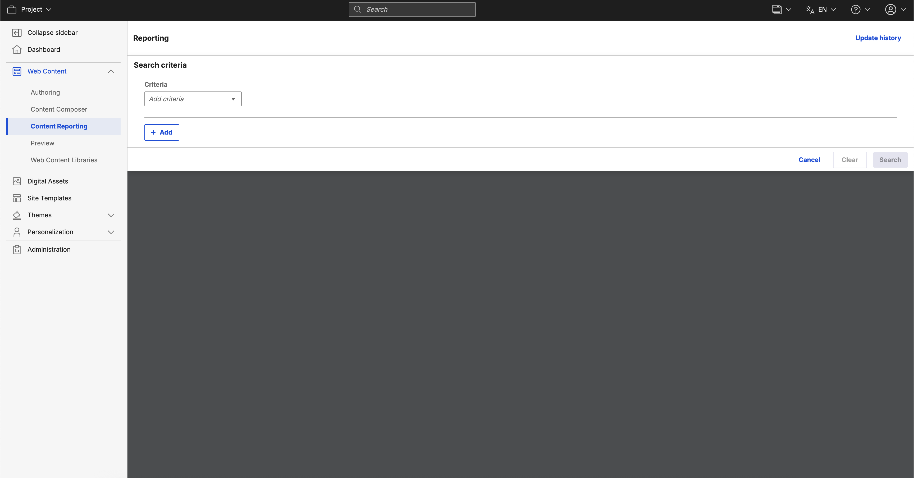

# Bookmarking a generated report

Content managers can bookmark reports generated using HCL Content Reporting.

1. Log in to your HCL Digital Experience (DX) Compose 9.5 platform and select **Web Content**, then select **Content Reporting** from the Practitioner Studio navigator.

    

2. Create a report on search items you want to bookmark. See the [Generating a content report](../usage/generate_content_report.md) for further instructions.
3. After generating a report, you can bookmark the page in your browser or copy the URL in the address bar to share the report.

## Automatic refresh in reports

Reports automatically reload when you switch tabs and then return to the **Content Reporting** tab.
